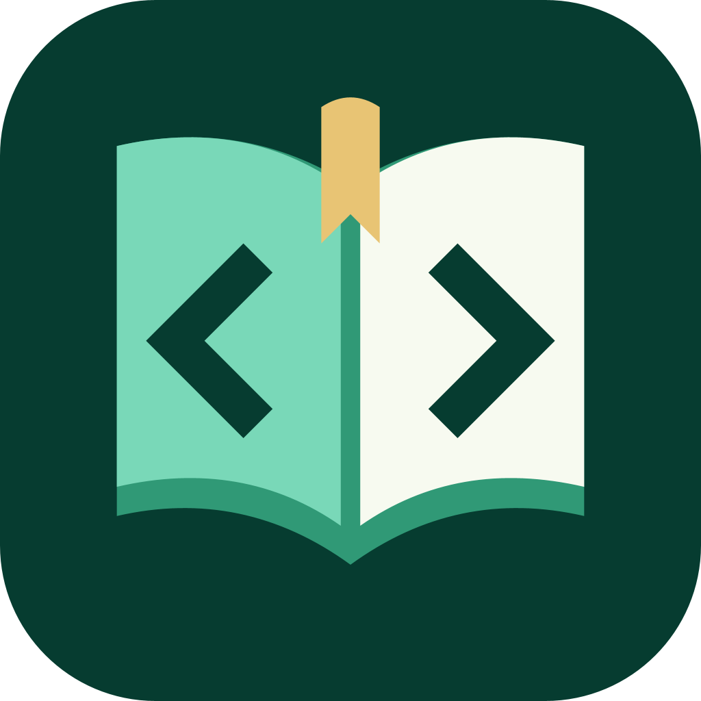
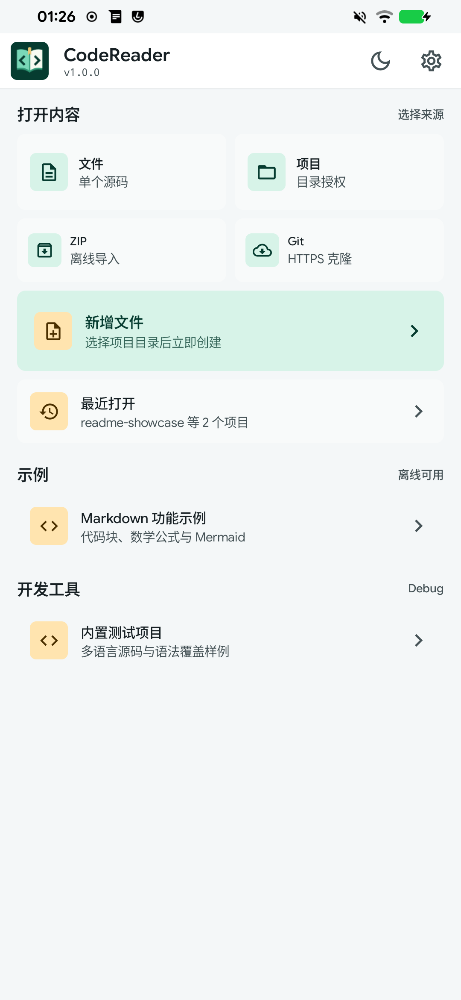
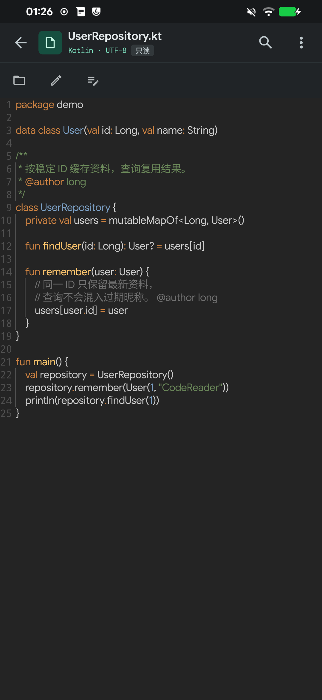
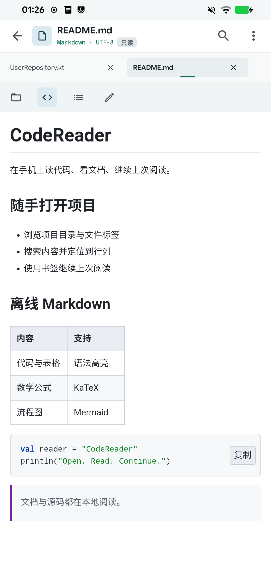

<div align="center">



# CodeReader

**在手机上读代码、看文档、继续上次阅读。**

Android 原生源码与 Markdown 阅读器，支持项目浏览、搜索定位和轻量编辑。

[](https://github.com/lonnnnnng/CodeReader/releases/latest)


[](LICENSE)

[下载 APK](https://github.com/lonnnnnng/CodeReader/releases/latest) · [反馈问题](https://github.com/lonnnnnng/CodeReader/issues) · [产品路线图](docs/产品路线图.md)

</div>

## 下载与安装

当前版本：**[CodeReader v1.0.0](https://github.com/lonnnnnng/CodeReader/releases/tag/v1.0.0)**。

- [CodeReader-v1.0.0-arm64-v8a.apk](https://github.com/lonnnnnng/CodeReader/releases/download/v1.0.0/CodeReader-v1.0.0-arm64-v8a.apk)
- [SHA256SUMS](https://github.com/lonnnnnng/CodeReader/releases/download/v1.0.0/SHA256SUMS)

要求 Android 7.0/API 24 以上与 **arm64-v8a** 处理器。正式应用 ID 为 `com.codereader.app`，应用名称统一为 **CodeReader**。

## 阅读体验

<table>
  <tr>
    <td align="center"><br>文件与项目入口</td>
    <td align="center"><br>原生代码阅读</td>
    <td align="center"><br>离线 Markdown 文档</td>
  </tr>
</table>

### 文件与项目

从系统文件选择器打开文件或目录，也可以从其他应用分享文件。ZIP 项目、公开 HTTPS Git 仓库与内置示例使用统一的文件浏览和阅读流程。

- 可折叠项目目录树、最近项目、文件名与路径筛选。
- 多文件标签页、文件书签、行书签和阅读位置恢复。
- 项目全局搜索与文件内搜索，支持大小写、整词、正则、文件类型和目录范围。
- 精确行列跳转、上一处/下一处命中、命中统计与截断提示。
- 可写项目根目录支持新增文件，可选择 77 个常见文件模板。

### 代码阅读与轻量编辑

使用原生 Sora Editor 显示行号、语法高亮、光标与选区。支持约 78 种文件类型，覆盖 Java、Kotlin、Python、Go、Rust、C/C++、JavaScript/TypeScript、Vue、JSON、YAML、SQL、Shell 和常见工程配置。

- 默认只读，可写文件可以进入编辑模式。
- 撤销/重做、查找替换与正则捕获组替换。
- 自动缩进、括号和引号补全、2/4/8 Tab 宽度、空格或 Tab 缩进。
- 当前行选择、删除、复制、剪切、粘贴、缩进与反缩进。
- 草稿在后台按顺序持久化；关闭前仍未落盘的修改会补写。
- 原文件被外部修改时，先选择保留文件内容或恢复草稿。
- 本地保存使用原子替换，SAF 写入失败会尝试恢复原始内容。

### Markdown 文档

Markdown 源码与预览可以互相切换，保留阅读位置。渲染脚本与字体随 APK 内置，离线可用。

| 文档内容 | 阅读辅助 |
| --- | --- |
| 标题、列表、引用、表格、任务列表、脚注 | 可折叠目录、标题跳转、代码块复制 |
| 代码高亮、KaTeX 数学公式、Mermaid 流程图 | 源码/预览位置同步、跨标签预览缓存 |
| YAML Front Matter、本地图片与相对附件 | 图片放大、局部错误占位与源码回退 |
| 自包含 HTML、系统 PDF 打印导出 | 分享渲染结果、复制渲染文本 |

### 大文件与编码

自动识别 UTF-8、UTF-8 BOM、UTF-16、GB18030/GBK、Big5 和 Latin-1，可手动切换编码。保存沿用当前编码与 BOM。

大文件按设备内存进入只读分段模式，搜索继续扫描未加载内容，命中后可以补页定位。分页只为最近阅读的文件保留打开流，缓存淘汰后可从原位置继续读取。不可写来源和大文件可以导出完整原始字节副本，保留编码、BOM 与换行。

### Git 与在线更新

公开 HTTPS 仓库支持浅克隆与安全快进更新。获取更新后先展示提交和文件变化；本地修改、未跟踪文件、未保存草稿或分支分叉会阻止自动应用。

应用更新来自本仓库的正式 Release，安装前校验 APK 的大小、SHA-256、应用 ID、版本与签名，再交给系统安装器。

## 使用边界

- Git 当前支持公开 HTTPS 仓库，暂不提供私有仓库认证、SSH、分支检出和应用内冲突解决。
- 分段大文件保持只读；新增文件目前位于项目根目录。
- Markdown 默认关闭原始 HTML 和远程图片加载，本地资源限于当前项目索引。
- 编译、运行、调试、完整 LSP 和 IDE 级重构不属于当前能力。

## 从源码构建

需要 **Java 17**、Android SDK 36；使用仓库内 Gradle Wrapper。

```sh
git clone https://github.com/lonnnnnng/CodeReader.git
cd CodeReader
./gradlew :app:assembleDebug
```

Debug APK：`app/build/outputs/apk/debug/app-debug.apk`，应用 ID 为 `com.codereader.app.debug`。

```sh
./gradlew :app:testDebugUnitTest :app:lintDebug :app:assembleDebug \
  :app:assembleDebugAndroidTest :app:assembleRelease --console=plain
```

Debug 与 Release 均只包含 `arm64-v8a`。正式签名与发版步骤见 [发布说明](docs/releasing.md)；当前真机验收结果见 [验证报告](docs/真机验证报告.md)。

## 技术实现

| 层次 | 实现 |
| --- | --- |
| 界面与导航 | Kotlin、Jetpack Compose、Material 3 |
| 源码阅读与编辑 | Sora Editor、TextMate、Joni 正则引擎 |
| Markdown | WebView、markdown-it、highlight.js、KaTeX、Mermaid |
| 文件与项目 | Storage Access Framework、DocumentFile、ZIP、Eclipse JGit |
| 状态与任务 | ViewModel、Coroutines、独立草稿队列、阅读状态持久化 |

图标使用独立前景、背景和单色图层，支持方形、圆形与 Android 自适应裁切。可编辑源文件、预览与重建命令见 [图标说明](branding/README.md)。

## 隐私与许可

源码与文档默认在本地处理。草稿保存在禁止系统备份的应用私有目录；网络用于用户主动触发的 Git 操作和应用更新。

项目使用 [Apache License 2.0](LICENSE)，第三方依赖及资源声明见 [THIRD_PARTY_NOTICES.md](THIRD_PARTY_NOTICES.md)。
