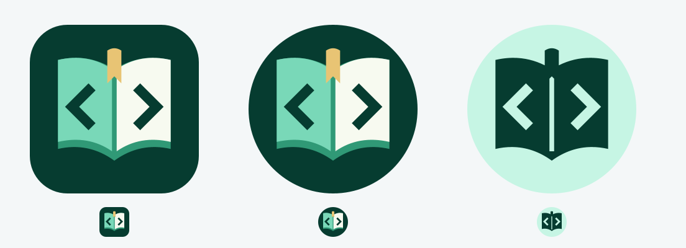

# CodeReader 图标

图标以展开的书页承载代码括号，用书签强调“继续阅读”。翡翠绿与应用默认配色一致，暖白书页保留文档感。



图标来自可编辑的矢量几何。Android 使用独立的 108dp 前景和纯色背景，主体保持在中央 66dp 安全区域；方形、圆形和系统自适应裁切共享同一主体。Android 13 以上另有单色图层，旧系统使用独立的方形与圆形矢量资源。

从项目根目录重新生成全部资源与 PNG/SVG 预览：

```sh
java -Djava.awt.headless=true scripts/GenerateIcons.java
```

生成器只依赖 Java 17 标准库，几何与配色统一维护在 `scripts/GenerateIcons.java`。图标源资源位于 `app/src/main/res/drawable/` 与 `app/src/main/res/mipmap-anydpi*/`。

尺寸与图层约束依据 [Android 自适应图标文档](https://developer.android.com/develop/ui/views/launch/icon_design_adaptive)，核验日期为 2026-11-14。
