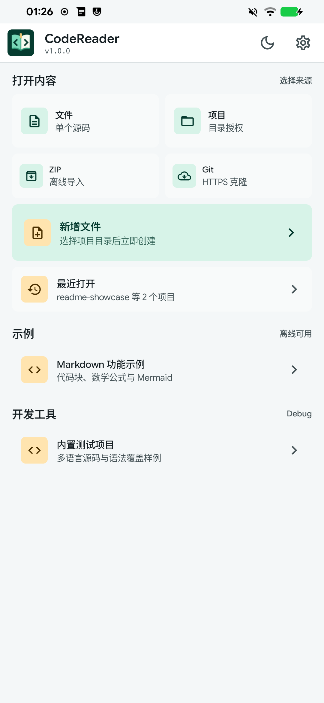
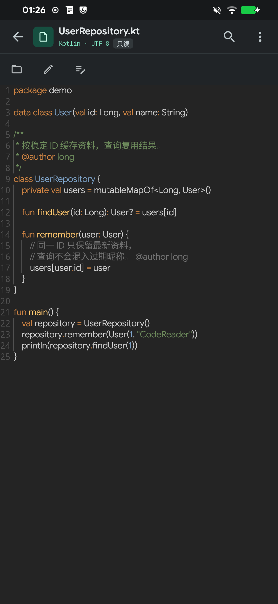
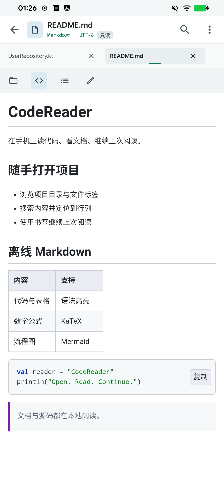

# CodeReader 1.0.0 真机验证报告

> 设备：Redmi Note 8 Pro，Android 16 / API 36，arm64-v8a，应用堆上限 256 MB。  
> 验证日期：2026-11-14～2026-11-15（北京时间）。  
> 正式应用：`com.codereader.app`；调试应用：`com.codereader.app.debug`。

## 本次优化

- 分页、按行跳转和编码重读校验发起文件的正文快照，旧结果不写入另一个标签或重开的文件。
- 草稿读取、写入和删除共享进程内的目录事务队列；快速退出后重新打开，会先完成旧页面的最终写入。
- 草稿防抖与待落盘标记分离，退出仅补写尚未完成的快照，磁盘同步在后台执行。
- 项目搜索统一 CR、LF、CRLF 换行语义，超长行不再随字符页反复拼接；展示截断后仍统计所有命中。
- 正则替换复用一次编译结果，保留大小写、整词、捕获组与原始换行。
- 分页游标使用 4 项 LRU，淘汰关闭流，后续加载按原始字符位置恢复。
- Markdown 资源表只在进入预览时构建，同一项目的多个预览共享路径表。
- 延迟滚动恢复核对文档、正文版本和定位命令，避免旧帧影响新标签。
- 应用身份、源码包路径与发行名称统一为 CodeReader，构建只保留 arm64。
- 新图标包含方形、圆形、自适应及单色图层；首页使用同一书页标识。
- 项目搜索路径输入框提供“完成”操作，收起键盘后可继续检查并应用筛选选项。

## 构建与静态检查

```sh
./gradlew :app:testDebugUnitTest :app:lintDebug :app:assembleDebug \
  :app:assembleDebugAndroidTest :app:assembleRelease --console=plain
```

- JVM 单测：69/69 通过。
- Lint：无错误，30 项警告；包括依赖版本提示、JGit 库内部 TLS 实现提示及既有样式建议。
- Debug、AndroidTest、R8 Release 构建通过。
- 正式包名、名称、版本与 ABI 已通过 APK 元数据检查；签名 v2 校验通过。
- 正式签名版已在 Redmi 实测安装、冷启动、内置项目浏览、Markdown 渲染（本地图片、公式与流程图）及源码语法高亮。

## 真机回归

发布前功能用例：**100/100 通过**（整轮回归与最终定向复测合并计算，不把重复执行计为新用例）。

最后一轮整轮回归执行 100 项，其中 98 项通过；公开 GitHub 克隆遇到连接超时，搜索弹层测试发现路径输入框没有配置键盘“完成”操作。补齐实际输入体验后，整个搜索弹层测试类与 Git 克隆定向复测 **17/17 通过**，覆盖上述两项失败。结果记录分别为 `codereader-redmi-release-regression.txt` 与 `codereader-redmi-targeted-final.txt`，位于本地 `app/build/reports/`。

覆盖新包名、Provider、图标资源、公开 HTTPS Git 克隆、更新预览、修改保护、目录索引、编码、分页、10 MB 以上文本全文搜索、读取竞态、草稿重建、保存回滚、原始文件导出、源码编辑、Markdown、设置、书签与阅读位置。

语法覆盖以 8 个独立 instrumentation 进程执行，分片结果为 10、10、10、10、10、10、9、9，合计 **78/78 样例通过**。每个分片仍验证实际 grammar 加载与语义 token，避免在小堆设备中同时保留全部分析缓存。

```sh
adb -s "$CODEREADER_DEVICE_SERIAL" shell am instrument -w -r \
  -e class com.codereader.app.SyntaxCoverageInstrumentedTest \
  -e syntaxShardCount 8 -e syntaxShardIndex 0 \
  com.codereader.app.debug.test/com.codereader.app.ServiceLoaderBridgeRunner
```

分片索引依次为 0～7。功能回归只执行新应用测试包；线上更新检查依赖本次正式发行资产，发布后单独验证。

## 真实界面

README 三张截图来自上述 Redmi 真机。截图任务验证当前项目索引、已挂载编辑器的真实着色 span 和 Markdown 加载完成；重复打开项目可自动恢复文档，不强制等待浏览页。





## 验证边界

本轮设备范围为 Redmi Note 8 Pro / Android 16。其他 Android 版本与设备没有复测；HTML/PDF 的系统最终保存或外部分享结果没有新增手工验收。项目搜索仍需完整解码单条超长行，复杂正则没有硬性单行超时。

最终 APK 摘要以发行附件 `SHA256SUMS` 为准，发行文件为 `CodeReader-v1.0.0-arm64-v8a.apk`。
